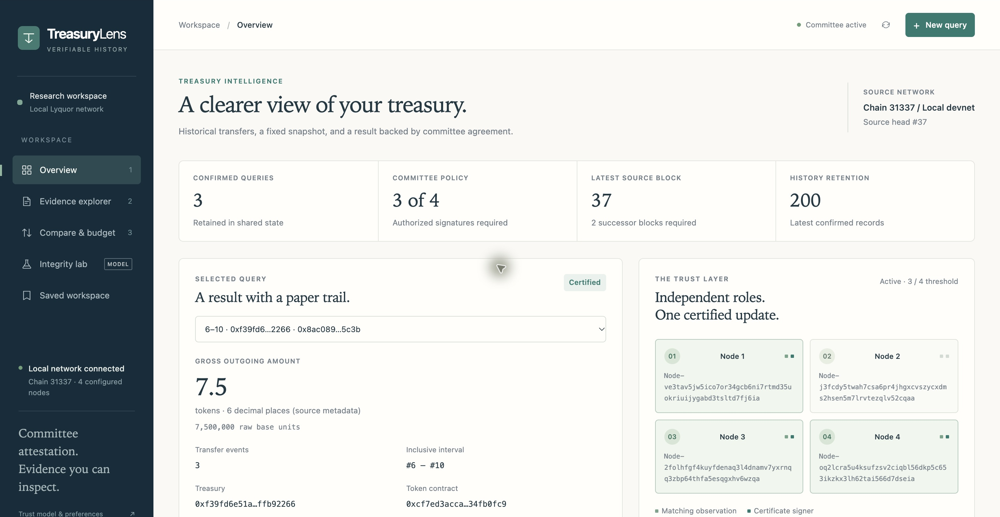
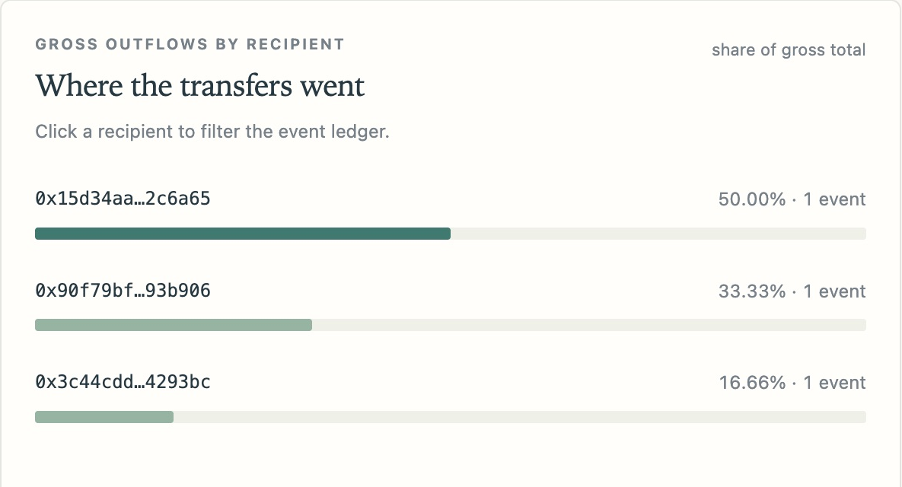
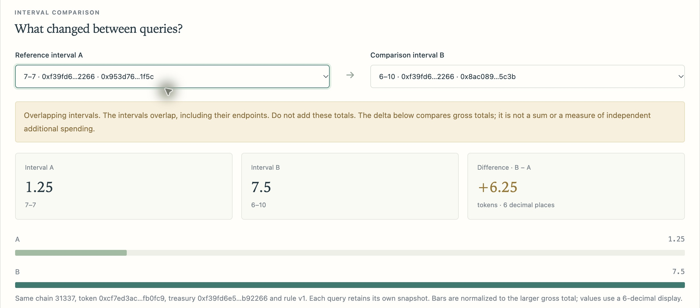

# TreasuryLens

**DAO 金库历史转账核验服务。** 在本地 Lyquor 四节点网络上，各节点读取真实 ERC-20 转账日志，核对同一历史快照，使用 3-of-4 oracle certificate 将结果写入共享状态。网页显示转出总额、事件数量、快照、日志摘要及签名节点；独立 Budget Monitor Lyquid 可读取已确认结果。

本项目范围是完整应用、测试、实验基础设施和运行文档；当前不包含最终课程报告、Demo 视频或 PPT。中文操作步骤见 [使用指南](docs/USER_GUIDE.zh-CN.md)，功能贡献与限制见 [贡献说明](docs/CONTRIBUTIONS.zh-CN.md)。金额均为代币最小单位，**转出总额不等于净流出、会计支出或欺诈判定**。

迁移到另一台电脑请先阅读 [启动说明](START_HERE.zh-CN.md)，运行 `bash Start-TreasuryLens.sh`。完整迁移包包含固定版本 LDK 源码及网站图文手册；首次启动仍需联网下载适配平台的工具与编译依赖。

## Download and run

```sh
git clone https://github.com/Innoall/TreasuryLens.git
cd TreasuryLens
bash Start-TreasuryLens.sh
```

Alternatively use **Code → Download ZIP**, extract it, and run the same launcher from the extracted folder. Read [Chinese startup instructions](START_HERE.zh-CN.md) for prerequisites and Windows WSL2 steps. The complete illustrated feature guide is [网站全功能图文手册](manual/TreasuryLens_网站全功能图文手册.pdf). This repository hosts the source; the live application runs on your own local network at the URL printed by the launcher, normally `http://127.0.0.1:8080/`.



## What is implemented

- A deterministic Rust core for normalized query IDs, strict ERC-20 event validation, checked uint256 summation, duplicate handling, canonical event digests and distinct-node quorum selection.
- A Lyquid adapter that reads local-chain RPC from each instance, checks endpoint snapshot stability and submits a threshold-certified result through the LDK oracle protocol.
- A hosted, dependency-free HTML/CSS/JavaScript console using actual application HTTP endpoints, with query/evidence workflows and browser-side comparison, saved-query and fault-model tools. Browser-only tools are distinguished from live node operations; Chrome interaction and chart layout checks are documented in `docs/BUTTON_CHECK.zh-CN.md` and `docs/CHART_CHECK.zh-CN.md`.
- Source replay anchored to the exact retained certified summary, with transaction, recipient and block drilldowns; endpoint-hash revalidation; and portable strict-schema evidence checked through HTTP or an independent offline CLI.
- A separate Budget Monitor Lyquid that reads a persisted certified result through an inter-Lyquid call.
- Pinned local tool setup, four-node network lifecycle, real Solidity token/transaction seeding, deployment and automated checks.
- An **explicitly separate test deployment** for controlled wrong-total, stale-snapshot and unavailable-response experiments. Production features do not enable fault controls by default.

A certificate establishes committee agreement under the stated assumptions. It is not a ZK proof, a light-client proof, or proof that RPC data is complete. Read [Security and limitations](docs/SECURITY.md) before interpreting results.

## Requirements

macOS or Linux, arm64 or amd64, internet access for first-time tool/compiler downloads, Bash, Python 3.10 or newer, curl and tar. JavaScript syntax checks also require Node.js; the hosted app itself needs no package install or frontend build. Docker, wallet extensions, cloud accounts, paid APIs and public-chain funds are not needed.

The setup pins Rust **1.99.0**, Lyquor/LDK **v0.8.3**, Foundry **v1.7.1** and Solidity **0.8.30** (EVM `paris`). Rust dependencies are recorded in `Cargo.lock`. Downloads go to `.tools/`; scripts do not modify shell startup files. Public Anvil development keys are deliberately used only against loopback test services.

## Run the project

For a fresh session, the convenience launcher performs bootstrap, network startup, seeding, both deployments and serving in one foreground command:

```sh
bash scripts/start.sh
```

It expects the local network ports to be free; Ctrl-C stops the project-owned network. The individual steps below are useful for development and troubleshooting.

From the repository root:

```sh
bash scripts/bootstrap.sh
```

Keep the network running in terminal A:

```sh
bash scripts/localnet.sh
```

In terminal B, create real test transactions, deploy and activate the committee, then serve the app:

```sh
python3 scripts/seed.py
bash scripts/deploy.sh
bash scripts/serve.sh
```

Open the localhost URL printed by `shaker serve` (normally `http://127.0.0.1:8080`). Keep terminals A and B running. The seeded query is filled from shared defaults. Click **Verify outflows**. The expected gross total is **7,500,000 base units**, with **3 outgoing Transfer events**. The test token has 6 decimals, so this represents 7.5 test tokens. An inbound transfer and an unrelated sender's transfer are excluded.

The service may first return **Submitted**: a certificate was submitted, but the network result has not yet been observed. The interface polls shared records and only shows **Confirmed** after the result is present. A receipt or HTTP 202 alone is not confirmation.

### Runtime files and restarting

- `.runtime/seed.json`: token, treasury, inclusive block range, endpoint hash, known expected values and actual transaction hashes.
- `.runtime/deployment.json`: current Lyquid identity, EVM wrapper address, committee, threshold, epoch, manifest and defaults.
- `.runtime/network/`: generated node configuration, databases and logs.
- `.runtime/deploy.stdout.log` and `deploy.stderr.log`: build/deployment diagnostics, including failed builds.

Ctrl-C in the serving terminal stops the proxy; Ctrl-C in the network terminal stops only processes started by that network. The next network start creates a fresh chain and archives the prior network/seed/deployment under `.runtime/previous-network.*`. Seed and deploy again for that chain. Do not reuse addresses from an old session.

If required ports are occupied, the wrapper exits without terminating their owner. `seed.py` reuses a saved dataset only when its contract and snapshot still match the live chain. Use `python3 scripts/seed.py --force` to intentionally create another dataset; redeploy or update defaults afterwards.

### Update an existing development deployment

If the network and serving proxy are already running, preserve the Lyquid identity while deploying changed code:

```sh
TL_UPDATE_LYQUID="$(python3 -c 'import json; print(json.load(open(".runtime/deployment.json"))["lyquid_id"])')" bash scripts/deploy.sh
```

This opts into `shaker deploy --update` for the saved identity. The script verifies or configures the intended committee, activates it when needed, and refreshes defaults. Assets-only updates preserve the existing active epoch and retained records; an unexpected committee is never silently replaced. **A code update in the current LDK resets this Lyquid's application state**: prior retained results, committee state and cached local observations must not be assumed to survive. Query again to regenerate confirmed records. Keeping the identity lets the existing serving proxy continue targeting the same app, but does not promise uninterrupted readiness during update/setup. Confirm `/api/status` and current records before using it. The normal `scripts/start.sh` workflow still starts a fresh network; it does not automatically update an existing session.

## Tests

Run deterministic core tests and source syntax checks without a running devnet:

```sh
bash scripts/test.sh
```

With the normal deployed app and serving proxy running:

```sh
python3 tests/integration.py --base-url http://127.0.0.1:8080
```

This checks the live committee, known outflow, repeated queries, empty history, invalid input, noncontract tokens, initializer authorization and the unavailable plain commit route. It writes a run record to `output/results/integration.json`. Consult that file and the command exit status for the current run; the existence of a test does not mean it has passed.

### New replay/evidence API checks

After deploying the current app and serving it, run:

```sh
python3 tests/api_v2.py --base-url http://127.0.0.1:8080
```

The 14 implemented checks cover exact-summary replay and reconciled drilldowns, current endpoint revalidation, valid and tampered evidence, strict schema, malformed/oversized input, missing records and record immutability. This writes `output/results/api-v2.json`. On 2026-11-12, the v2 test-manifest deployment passed all 14 API checks; this is distinct from subsequently testing the current normal deployment or frontend in a browser.

For all automated checks on a running **normal** deployment with its consumer already deployed:

```sh
bash scripts/check-release.sh
```

It runs Rust/source checks, normal integration, v2 APIs, the independent consumer and synthetic ablation. `TL_BASE_URL` can select another serving URL. It does not restart the network, perform native-browser interaction or obtain user feedback. The consumer prerequisite is satisfied by `scripts/start.sh`; for manual startup also run `bash scripts/deploy-consumer.sh` first.

### Controlled fault experiments

Leave the network running, but stop the current serving proxy with Ctrl-C. Deploy the **test manifest** and serve the new deployment:

```sh
TL_MANIFEST="$PWD/lyquids/treasurylens-test/Cargo.toml" bash scripts/deploy.sh
bash scripts/serve.sh
```

Then, in another terminal:

```sh
python3 tests/integration.py --base-url http://127.0.0.1:8080 --faults
```

The test manifest enables `test-controls`; `/api/status` must report `test_controls: true`. Tests inject one wrong total, one stale snapshot, one unavailable response, two unavailable responses and two wrong totals. They use fresh query snapshots so a prior confirmed record does not bypass the oracle. Records are written to `output/results/integration-faults.json`.

These are **real four-node protocol runs with injected application responses**, not a measurement of physically disconnected machines or independent RPC operators. `unavailable` returns a signed source-read failure without a summary; it does not stop the node process. With four signed replies but no matching three summaries, aggregation can certify an explicit rejection, which HTTP reports without writing a successful record. Physically missing replies or a powered-off node are a separate platform/liveness limitation and have not been established by these injection tests. The fault setter is intentionally public and must remain restricted to this local test deployment. Restore the normal app by stopping the proxy and deploying again without `TL_MANIFEST`:

```sh
bash scripts/deploy.sh
bash scripts/serve.sh
```

### Deterministic policy ablation

This optional utility compares synthetic observation inputs for a single-node rule, a totals/count-only majority rule and the full snapshot-bound rule:

```sh
source scripts/env.sh
mkdir -p output/results
cargo run --locked -p treasurylens-core --bin evaluate < evaluation/observed/certified-record.json > output/results/ablation.json
```

It checks the supplied record's schema/bindings, not its committee certificate, and creates synthetic node observations. It measures acceptance behavior under explicit fault models, **not devnet latency, throughput, real attack frequency or commercial-system performance**. Observed evidence and its limits are described in [evaluation notes](evaluation/README.md).

## Replay, revalidate and verify portable evidence

Select a retained confirmed record and request a replay in the Evidence workspace. The backend rereads the stored query from the current source RPC, with snapshot checks before and after reading, then compares **every summary field** with the retained certified record. Only a full match releases raw logs and the corresponding transaction, recipient and block breakdowns. Replayed detail is a one-instance source/content check, **not a new committee certificate**.

Recipient/block sums use uint256 integers; recipient shares are floor basis points using widened U512 intermediate arithmetic. Self-transfers remain included in the gross summary and are separately explained. Optional token decimals come from an exact-snapshot `eth_call`, are labeled untrusted source metadata, and do not alter the certified base-unit total.

Snapshot revalidation checks whether the current source RPC reports the same hash at the stored endpoint height. A match does not prove strong finality. A changed/unavailable endpoint is shown separately and never deletes or silently rewrites the historical certificate.

Evidence export/import has exactly these top-level fields: `{schema_version: 1, query, summary, logs}`. Unknown fields, unsupported versions and malformed log data are rejected. Imports are limited to **1 MiB and 10,000 logs**. Export compact JSON and check its actual byte size; pretty printing can exceed the limit. A valid imported bundle means its supplied contents reproduce its supplied summary. It does **not** authenticate an uploader, source chain, original retained record or committee signatures; an attacker can rewrite a bundle and recompute its summary.

To independently reconstruct an exported file without a running Lyquor service:

```sh
source scripts/env.sh
cargo run --locked -p treasurylens-core --bin verify-evidence < evidence.json
```

The CLI enforces the same strict core rules and 1 MiB input limit, emits a content-verification result, and returns a nonzero exit code on failure. It makes no RPC reads and verifies no committee certificate. Compare its query/summary with a separately trusted record to establish the intended anchor.

## Independent Budget Monitor

After the source app has confirmed a query:

```sh
bash scripts/deploy-consumer.sh
source scripts/env.sh
```

The deployment is saved to `.runtime/budget-monitor.json`. Set `QUERY_ID` to a confirmed record's full ID from the app, then call the monitor:

```sh
MONITOR="$(python3 -c 'import json; print(json.load(open(".runtime/budget-monitor.json"))["contract"])')"
QUERY_ID='paste-a-confirmed-query-id-here'
cast send --rpc-url "$TL_PRIMARY_WS" --private-key "$TL_ANVIL_KEY" \
  "$MONITOR" 'check_budget(string,uint256)' "$QUERY_ID" 6000000
cast call --rpc-url "$TL_PRIMARY_WS" "$MONITOR" \
  'get_check_json(string,uint256)(string)' "$QUERY_ID" 6000000
```

The send command sequences a network transaction because the cross-Lyquid atomic read cannot run through the read-only instance alias. Repeat/poll `get_check_json` until it is no longer `"null"`; a transaction receipt alone is not a completed application decision. A retained source result produces `status: confirmed`; an unknown/evicted source result produces a persisted `status: rejected` decision. For the seeded total and a budget of 6,000,000, the intended result is `budget_exceeded: true`. The monitor reads the source Lyquid; it never accepts a caller-supplied total. Redeploy it after changing the source deployment. Decisions are cached by `(query_id, budget)`; repeating an existing key does not recheck the source. At 200 cached decisions, the next new key clears the check cache before inserting the new decision. A previously cached rejection does not automatically change if that source result appears later. The page's budget comparison is a separate browser calculation and is labeled accordingly; it is not itself a committee-certified budget decision.

## Architecture and API

See [Architecture](docs/ARCHITECTURE.md) for state boundaries, wire fields and result retention, and [Security](docs/SECURITY.md) for trust assumptions and review findings.

- `GET /api/status`: live configuration, source-chain head, defaults and test-build indicator.
- `POST /api/query`: `{token, treasury, from_block, to_block, budget?}`. Budget is an optional unsigned decimal string; historical query identity does not include the display threshold.
- `GET /api/results`: currently retained confirmed records.
- `POST /api/audit`: `{query_id}` → `matched`, `mismatch` or `unavailable`; only matched responses include `audit` and raw `logs`, with `scope: source-replay-not-new-certificate`.
- `POST /api/revalidate`: `{query_id}` → `canonical`, `changed` or `unavailable`, expected/current endpoint hashes, check time and successor-block depth; no certified-state mutation.
- `POST /api/verify-evidence`: the strict four-field bundle → `valid`/`invalid`, optional recomputed audit, `scope: supplied-contents-only` and always `certificate_verified: false`.
- ETH view `get_result_json(string)`: a retained record as JSON, or `"null"` if absent.

Results retain the latest **200 newly inserted query IDs** in deterministic insertion order. Repeated existing IDs are idempotent and do not refresh that order. New requests can evict older results; there is no permanent historical archive or access control on public queries.

## Repository layout

```text
crates/treasurylens-core/     Deterministic query/statistics/quorum logic
lyquids/treasurylens/        Normal Lyquid and hosted assets
lyquids/treasurylens-test/   Separate manifest enabling test-only fault controls
lyquids/budget-monitor/     Independent consumer Lyquid
contracts/TestToken.sol     Real local test ERC-20
scripts/                    Setup, network, seed, deployment, serving and checks
tests/                      Live normal/fault, v2 API and consumer checks
docs/                       Architecture, security, attribution and AI use
```

## Interface examples

Recipient bars support evidence-ledger filtering. Comparison checks query compatibility before displaying interval deltas. Screenshots below were captured from the local application on 2026-11-13.





## Package a source handoff

```sh
python3 scripts/package.py
```

This writes `output/project/TreasuryLens-source.zip`, checks ZIP integrity, and includes source, lockfiles, docs, observed evaluation evidence and a per-file SHA-256 manifest. Test assets are materialized so extracting tools need not preserve the asset symlink. It excludes local tool downloads, runtime keys/databases, caches and generated output directories. The archive is a source handoff, not a deployed service or a final course submission; the recipient still runs bootstrap/start and checks. Packaging success does not imply tests or user review passed.

## Validation status and remaining work

Observed on 2026-11-11:

- **33 Rust tests passed**: 28 deterministic core tests plus 5 synthetic-ablation utility tests.
- The revised explicit-test deployment passed **14/14 real four-node integration/fault checks**: [fault run](evaluation/observed/fault-run.json).
- A clean `scripts/start.sh` run successfully bootstrapped the corrected network wrapper, seeded transactions, deployed the production app and consumer, and started serving.
- That clean production app passed **9/9 live integration checks**: [production run](evaluation/observed/integration.json).
- **4/4 independent consumer cases passed**: above-budget, equal-budget, below-budget and missing-query rejection, using actual sequenced cross-Lyquid calls: [consumer run](evaluation/observed/consumer.json).
- An initial normal certified result and its supporting/certifying node evidence are preserved in [certified record](evaluation/observed/certified-record.json).

The first broad attempt passed 11/14 and exposed source-failure/no-quorum requests waiting longer than 35 seconds despite the requested LDK timeout. That original [failure record](evaluation/observed/initial-fault-run.json) is retained. Preflight checks and signed negative responses fixed the selected responding-node failure cases, as shown by the revised 14/14 run. Actual missing packets can still exceed the desired runtime timeout; the UI uses a 65-second query request timeout and does not label a timed-out request successful.

On **2026-11-12**, the Rust suite passed **48 tests**: 43 library tests (including replay analytics, evidence binding and precision cases) plus 5 synthetic-ablation tests. The v2 backend built successfully. The separate v2 test-manifest deployment passed **14/14 live fault/integration checks and 14/14 v2 API checks**. Actual replay produced recipient amounts 3,750,000 / 2,500,000 / 1,250,000 and floor shares 5,000 / 3,333 / 1,666 basis points; its [compact evidence](evaluation/observed/v2-evidence.json) also passed the [independent offline CLI](evaluation/observed/v2-offline-verified.json). The [v2 API test run](evaluation/observed/v2-api-test-build.json) and [v2 fault run](evaluation/observed/v2-fault-run.json) preserve these actual outcomes. The upgraded normal deployment subsequently passed the complete release command: **48 Rust tests, 19 client-logic tests, 9 production integration checks, 14 replay/evidence API checks and 4 cross-Lyquid consumer checks**. Current [production integration](evaluation/observed/v2-production-integration.json), [production API](evaluation/observed/v2-production-api.json) and [consumer](evaluation/observed/v2-consumer.json) run records are preserved. All four hosted assets matched the local release bytes. Source packaging has its own archive/manifest verification. Prior-day run files remain historical evidence, not automatic validation of a new deployment.

The 4 consumer cases are separate from the 9/9 and 14/14 integration counts. On 2026-11-13, native Chrome button interactions, downloads, error feedback and responsive chart layouts were checked; see [button checks](docs/BUTTON_CHECK.zh-CN.md) and [chart checks](docs/CHART_CHECK.zh-CN.md). That deployment passed 10 production integration checks and 14 API checks. Outside-team user testing remains pending. The team still needs classmates to follow the README, record feedback, verify claims and review the implementation before course submission. Any deterministic synthetic policy ablation is distinct from these actual devnet outcomes and must not be presented as real-node performance.

See [Attribution](docs/ATTRIBUTION.md) and [AI use](docs/AI_USE.md). This is a course prototype with explicit local-only assumptions, not an audited financial product.

For Chinese operation and acceptance guidance, see [用户指南](docs/USER_GUIDE.zh-CN.md), [贡献与边界](docs/CONTRIBUTIONS.zh-CN.md), [验收清单](docs/ACCEPTANCE.zh-CN.md) and [真实用户测试协议](docs/USER_TEST_CHECKLIST.zh-CN.md).
